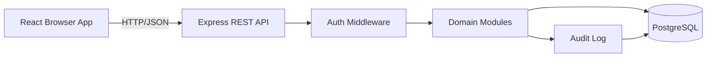
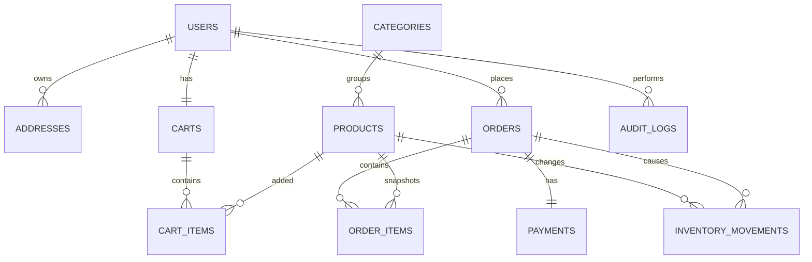
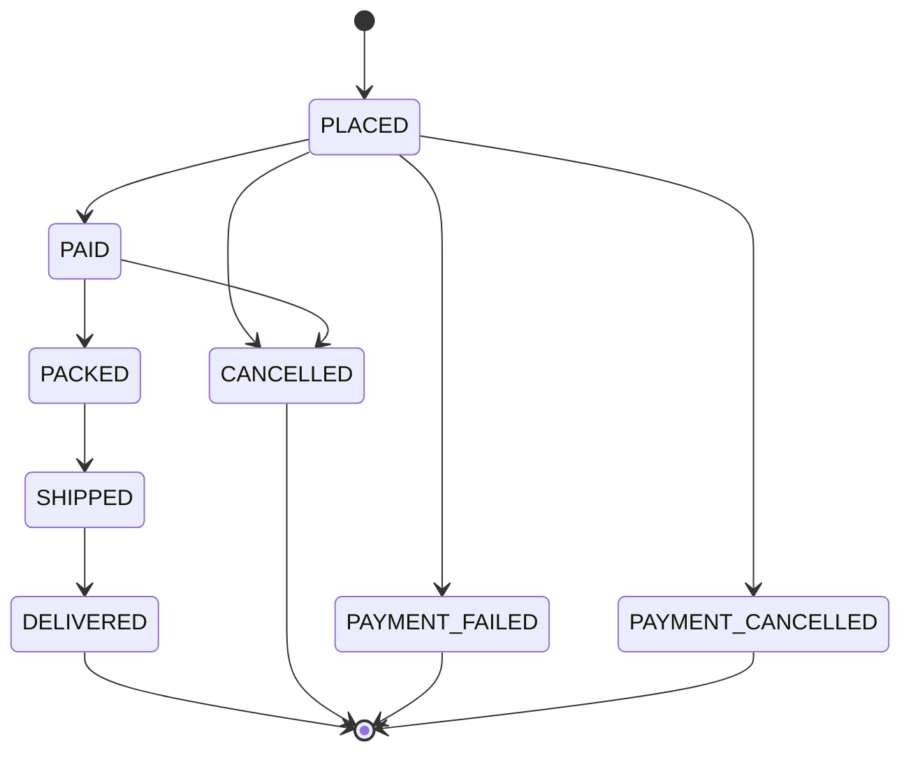

# Application Architecture

## E-Commerce Platform — PERN MVP

This document defines how the application is structured, how data moves through the system, and where business rules must be enforced.

The architecture is a **modular monolith**:

- One React frontend.
- One Express backend.
- One PostgreSQL database.
- Clear module boundaries inside the backend.

Microservices are unnecessary for this two-day assessment and would add operational complexity without improving the required outcome.

---

## 1. Architectural goals

The architecture must be:

- Simple enough to finish in two days.
- Structured enough to explain during a technical walkthrough.
- Secure by default.
- Transaction-safe for checkout and inventory.
- Testable at the business-rule level.
- Easy to run locally.
- Explicit about ownership and authorization.

The architecture must prioritize correctness over abstraction. Do not create layers that only add indirection without protecting a business rule.

---

## 2. High-level system



### Main runtime responsibilities

#### React frontend

- Render pages and components.
- Manage navigation and display state.
- Submit user actions to the API.
- Display loading, empty, success, and error states.
- Never make authorization decisions by itself.
- Never be the source of truth for prices, stock, order state, or permissions.

#### Express backend

- Authenticate requests.
- Authorize roles and resource ownership.
- Validate request bodies, query parameters, and route parameters.
- Apply business rules.
- Coordinate database transactions.
- Return predictable API responses.
- Write audit events for material actions.

#### PostgreSQL

- Persist users, products, carts, orders, payments, inventory, and audit records.
- Enforce uniqueness, foreign keys, check constraints, and indexes.
- Guarantee transaction boundaries for critical operations.
- Protect idempotency at the database level.

---

## 3. Repository structure

```text
ecommerce-platform/
├── client/
│   ├── src/
│   │   ├── api/
│   │   │   ├── client.ts
│   │   │   ├── authApi.ts
│   │   │   ├── catalogApi.ts
│   │   │   ├── cartApi.ts
│   │   │   ├── orderApi.ts
│   │   │   └── adminApi.ts
│   │   ├── components/
│   │   ├── features/
│   │   │   ├── auth/
│   │   │   ├── catalog/
│   │   │   ├── cart/
│   │   │   ├── checkout/
│   │   │   ├── orders/
│   │   │   └── admin/
│   │   ├── layouts/
│   │   ├── pages/
│   │   ├── routes/
│   │   ├── styles/
│   │   ├── types/
│   │   ├── App.tsx
│   │   └── main.tsx
│   └── package.json
├── server/
│   ├── src/
│   │   ├── config/
│   │   │   └── env.ts
│   │   ├── db/
│   │   │   ├── migrations/
│   │   │   ├── pool.ts
│   │   │   └── seed.ts
│   │   ├── middleware/
│   │   │   ├── auth.ts
│   │   │   ├── errorHandler.ts
│   │   │   ├── notFound.ts
│   │   │   └── validate.ts
│   │   ├── modules/
│   │   │   ├── auth/
│   │   │   │   ├── auth.controller.ts
│   │   │   │   ├── auth.routes.ts
│   │   │   │   ├── auth.schemas.ts
│   │   │   │   └── auth.service.ts
│   │   │   ├── users/
│   │   │   ├── catalog/
│   │   │   ├── cart/
│   │   │   ├── checkout/
│   │   │   ├── orders/
│   │   │   ├── inventory/
│   │   │   ├── reports/
│   │   │   └── audit/
│   │   ├── shared/
│   │   │   ├── errors/
│   │   │   ├── ids/
│   │   │   ├── money/
│   │   │   └── orderStates/
│   │   ├── app.ts
│   │   └── server.ts
│   ├── tests/
│   └── package.json
├── docs/
│   ├── api.md
│   └── er-diagram.md
├── .env.example
├── README.md
└── package.json
```

The exact file names may differ, but the boundaries should remain recognizable.

---

## 4. Backend module boundaries

### 4.1 Auth module

Responsibilities:

- Registration.
- Login.
- Logout.
- Current user.
- Password hashing and verification.
- Token or session creation.

The auth module should not contain product, cart, or order logic.

### 4.2 Users module

Responsibilities:

- Customer profile.
- Address management.
- Customer listing for admins.
- Ownership checks for addresses.

### 4.3 Catalog module

Responsibilities:

- Public product listing.
- Search, filtering, sorting, and pagination.
- Product detail.
- Category listing.
- Admin product and category management.

The catalog module owns product status and catalogue validation. It does not own order creation.

### 4.4 Cart module

Responsibilities:

- Retrieve the authenticated customer's cart.
- Add an item.
- Update quantity.
- Remove an item.
- Clear a cart.

The cart module may perform an early stock check for user feedback, but checkout must perform the authoritative stock check again.

### 4.5 Checkout module

Responsibilities:

- Validate checkout input.
- Validate address ownership.
- Read cart contents.
- Recalculate pricing.
- Lock product rows.
- Create order and order items.
- Update inventory.
- Record payment outcome.
- Enforce idempotency.
- Clear the cart according to the payment policy.

This is the most critical module in the application.

### 4.6 Orders module

Responsibilities:

- Customer order history.
- Customer order details.
- Customer cancellation where allowed.
- Admin order listing.
- Admin order details.
- Valid order status transitions.

State transition rules should live in one reusable service or helper, not be duplicated across controllers.

### 4.7 Inventory module

Responsibilities:

- Product stock updates.
- Inventory movement records.
- Low-stock queries.
- Safe stock decrement helpers.

Checkout should use the inventory module's transaction-aware functions rather than directly duplicating stock logic.

### 4.8 Reports module

Responsibilities:

- Dashboard metrics.
- Revenue calculation.
- Order counts.
- Low-stock summaries.

The revenue definition must be explicit, such as “sum of totals for `PAID`, `PACKED`, `SHIPPED`, and `DELIVERED` orders excluding cancelled orders.”

### 4.9 Audit module

Responsibilities:

- Record business actions.
- Query audit records for admins.
- Normalize audit metadata.

Audit logging must not cause sensitive values such as passwords, tokens, or payment credentials to be stored.

---

## 5. Request flow

### Standard request flow

```text
HTTP request
  -> Express route
  -> authentication middleware
  -> role/ownership middleware
  -> request validation
  -> controller
  -> service
  -> repository/database query
  -> service result
  -> controller response
  -> error middleware when needed
```

### Controller responsibilities

Controllers should:

- Read validated input.
- Read authenticated user information.
- Call the appropriate service.
- Map the result to an HTTP response.

Controllers should not contain long SQL transactions or complex business rules.

### Service responsibilities

Services should:

- Apply business rules.
- Coordinate repositories.
- Start and commit/rollback transactions when required.
- Produce domain errors.
- Request audit logging for material actions.

### Repository/database responsibilities

Repositories should:

- Execute parameterized SQL.
- Return typed records.
- Keep query details close to the data access layer.
- Never interpolate user input into SQL.

For a two-day project, a separate repository file per module is sufficient. Do not build a generic repository framework.

---

## 6. Authentication and authorization

### Authentication

The selected implementation may use:

- JWT stored in an HTTP-only cookie, or
- A secure server-side session.

Use one consistent approach. Do not store sensitive tokens in unsafe browser storage if an HTTP-only cookie can be used.

### Authorization layers

Authorization must be checked at three levels:

1. **Authentication:** Is the requester logged in?
2. **Role:** Is the requester an admin when an admin operation is requested?
3. **Ownership:** Does the resource belong to the requester?

Example:

```text
GET /api/orders/:id
  -> requireAuth
  -> service verifies order.user_id = req.user.id
  -> return order or 404/403 according to the chosen policy
```

The frontend may hide admin navigation from customers, but the API must reject unauthorized calls independently.

---

## 7. Data model relationships



Historical order data must use snapshots:

- Product name snapshot.
- Unit price snapshot.
- Delivery address snapshot.

This prevents later catalogue or profile edits from changing historical records.

---

## 8. Checkout transaction design

Checkout must use one database transaction.

```text
BEGIN
  -> validate idempotency key
  -> load address owned by customer
  -> load cart items
  -> SELECT products FOR UPDATE
  -> validate active products and stock
  -> calculate totals from database values
  -> INSERT order
  -> INSERT order items
  -> UPDATE products SET stock_quantity = stock_quantity - quantity
  -> INSERT inventory movements
  -> INSERT payment
  -> INSERT audit event
  -> clear cart if policy allows
COMMIT
```

On any error:

```text
ROLLBACK
```

The transaction must not partially create an order or partially deduct stock.

### Idempotency behavior

Use a unique constraint such as:

```text
UNIQUE(user_id, idempotency_key)
```

The service should:

1. Check for an existing order before starting expensive work.
2. Attempt the unique insert inside the transaction.
3. Handle a unique conflict by returning the existing order.

Do not silently create a new idempotency key on the server when the client reuses a request.

---

## 9. Order state machine



Keep the allowed transition map in one place:

```ts
const allowedTransitions = {
  PLACED: ['PAID', 'PAYMENT_FAILED', 'PAYMENT_CANCELLED', 'CANCELLED'],
  PAID: ['PACKED', 'CANCELLED'],
  PACKED: ['SHIPPED'],
  SHIPPED: ['DELIVERED'],
  DELIVERED: [],
  CANCELLED: [],
  PAYMENT_FAILED: [],
  PAYMENT_CANCELLED: [],
} as const;
```

The exact implementation may differ, but transition logic must not be scattered across UI components and route handlers.

---

## 10. API conventions

### Base URL

```text
/api
```

### JSON response convention

Success responses should return resource data directly or inside a consistent `data` property.

Errors must use:

```json
{
  "error": {
    "code": "INSUFFICIENT_STOCK",
    "message": "The requested quantity is not available.",
    "details": {}
  }
}
```

### HTTP status conventions

```text
200 Successful read/update
201 Successful creation
204 Successful deletion with no response body
400 Malformed or invalid request
401 Authentication required
403 Authenticated but not authorized
404 Resource not found
409 Conflict or stale business state
422 Valid request but invalid business operation
500 Unexpected server error
```

### Validation

Validate:

- Request body.
- Query parameters.
- Route parameters.
- Enum values.
- Positive quantities.
- UUIDs.
- Email format.
- Price ranges.
- Pagination limits.

Never pass unvalidated values into SQL or business logic.

---

## 11. Frontend architecture

### Routing

Use React Router or the repository's existing routing solution.

Routes should be grouped into:

- Public routes.
- Authenticated customer routes.
- Authenticated admin routes.

### API client

Use one configured API client for:

- Base URL.
- Credentials or authorization headers.
- JSON parsing.
- Common error normalization.

Do not duplicate authentication headers and error parsing in every component.

### State ownership

- Server data belongs in API/query state.
- Form values belong in local component state or a form library.
- Authentication state belongs in a dedicated auth provider/store.
- Cart data should be fetched from the server and refreshed after mutations.

Do not treat local cart state as authoritative.

### UI boundaries

Reusable components should include:

- Button.
- Input.
- Select.
- Table.
- Modal/confirmation dialog.
- Loading state.
- Empty state.
- Error message.
- Status badge.

Keep feature-specific business logic inside feature modules.

---

## 12. Testing architecture

### Unit tests

Test pure rules in isolation:

- Price calculation.
- Discount/tax/shipping calculation.
- Quantity validation.
- Order transition validation.
- Role checks.

### Integration/API tests

Test through the Express application:

- Registration and login.
- Protected routes.
- Product listing.
- Cart operations.
- Successful checkout.
- Insufficient stock.
- Duplicate checkout.
- Failed payment.
- Invalid state transition.
- Customer blocked from admin routes.

### Test database

Use a separate test database or a controlled test schema. Never run destructive test setup against a production database.

---

## 13. Deployment and environment

Required environment variables should be documented in `.env.example`:

```text
NODE_ENV
PORT
DATABASE_URL
JWT_SECRET or SESSION_SECRET
CLIENT_URL
```

Do not commit:

- `.env`.
- Passwords.
- Tokens.
- Private keys.
- Real payment credentials.
- Real customer data.

---

## 14. Architecture decisions

| Decision | Choice | Reason |
|---|---|---|
| Application shape | Modular monolith | Fast to implement and easy to explain |
| Database | PostgreSQL | Relational constraints and transactions |
| API | Express REST API | Simple, familiar, testable |
| Frontend | React | Fast development and component reuse |
| Money | Integer minor units | Avoid floating-point errors |
| Payment | Simulated | Required by the assignment without external cost |
| Inventory | Product-level stock | Sufficient for a two-day MVP |
| Duplicate checkout | Idempotency key + unique constraint | Protects against retries and double clicks |
| Authorization | Server-side middleware and ownership checks | Prevents UI-only security |
| Historical data | Snapshots in order records | Preserves order accuracy |

