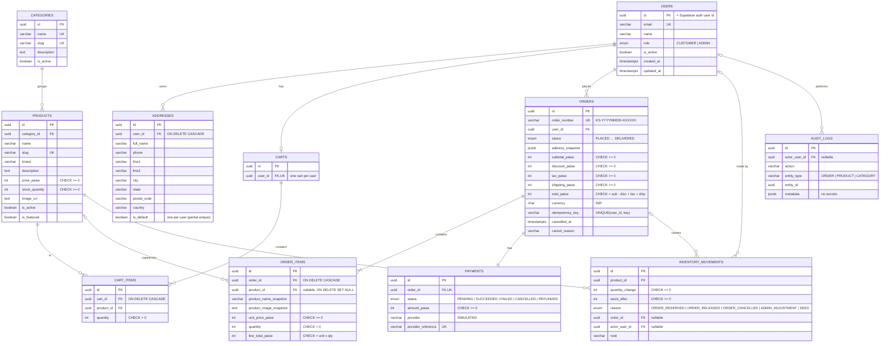

# Kickstead data model

Source of truth: [`database/prisma/schema.prisma`](../database/prisma/schema.prisma) and the SQL migrations in [`database/prisma/migrations/`](../database/prisma/migrations/). PostgreSQL on Supabase. Money is integer paise; timestamps are `timestamptz`; primary keys are UUIDs.

Every table also has `created_at`. Mutable tables have `updated_at`. Attributes are abbreviated in the diagram where obvious.

## Rules enforced by the database itself

| Rule | How |
|---|---|
| Stock never goes negative | `CHECK (stock_quantity >= 0)` on `products` and `CHECK (stock_after >= 0)` on movements, plus row locks and a conditional `UPDATE` in the app |
| Money is never negative and totals add up | `CHECK`s on every `*_paise` column; `total_paise = subtotal − discount + tax + shipping`; `line_total_paise = unit_price × quantity` |
| A checkout request can't create two orders | `UNIQUE (user_id, idempotency_key)` on `orders` |
| A customer can't reserve stock twice with parallel checkouts | Partial unique index `orders_one_placed_per_user ON orders(user_id) WHERE status = 'PLACED'` |
| One default address per customer | Partial unique index `addresses_one_default_per_user ON addresses(user_id) WHERE is_default` |
| One cart per user, one line per product | `UNIQUE (user_id)` on `carts`; `UNIQUE (cart_id, product_id)` on `cart_items` |
| Past orders don't change | Orders store copies of the address (`address_snapshot` JSONB) and of each item's name, image and unit price. `order_items.product_id` becomes `NULL` if a product is ever deleted. |
| Supabase's REST API can't read or write data | Row-level security is enabled with no policies on all 12 tables (including `_prisma_migrations`). The backend connects as the table owner through Prisma. |

## Indexes for common queries

- `products (is_active, created_at)` and `products (is_active, price_paise)` for catalogue sorting; `products (category_id)`; `products (stock_quantity)` for low stock
- `orders (user_id, created_at)` for order history; `orders (status, created_at)` for admin filters; `orders (created_at)`
- `inventory_movements (product_id, created_at)` and `(order_id)`; `audit_logs (created_at)`, `(entity_type, entity_id)`, `(actor_user_id)`
- Foreign-key indexes on `addresses.user_id`, `cart_items.product_id`, `order_items.order_id` and `order_items.product_id`

## Inventory ledger

`inventory_movements` is append-only. For every product, the sum of `quantity_change` equals `products.stock_quantity`, and each row's `stock_after` is the running total. `journey.test.ts` checks this across reservations, released payments, cancellations, refunds and admin adjustments.
